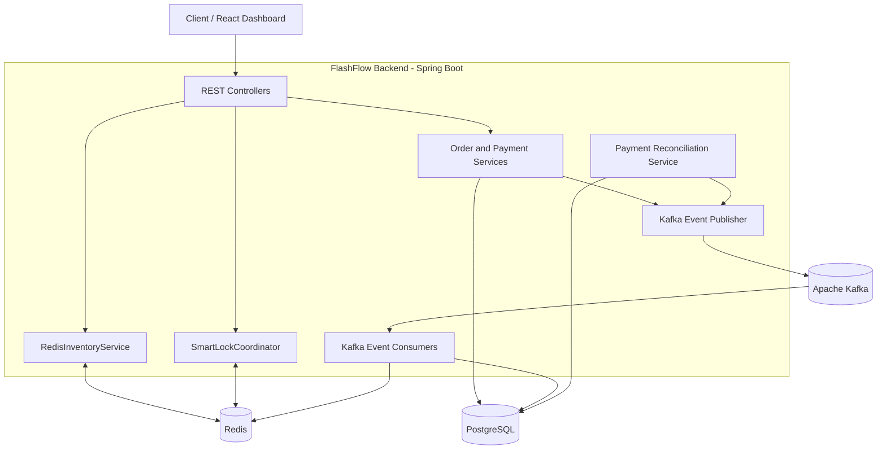

# ⚡ FlashFlow: Distributed Flash-Sale & Inventory Engine

A distributed flash-sale and inventory management system designed to handle high-concurrency checkout requests while preventing overselling, duplicate payment processing, and inventory inconsistencies.

Built with **Java 17, Spring Boot 3, Apache Kafka, Redis (Redisson), PostgreSQL, React 18, and Docker**.

**Author:** Riya Kumari  
**Email:** [riya123kumari1593@gmail.com](mailto:riya123kumari1593@gmail.com)  
**GitHub:** [riya07kumari](https://github.com/riya07kumari)


---

## 📌 Table of Contents

- [Overview](#-overview)
- [Key Features](#-key-features)
- [Technology Stack](#-technology-stack)
- [System Architecture](#️-system-architecture)
- [Concurrency and Inventory Management](#-concurrency-and-inventory-management)
- [Event-Driven Architecture](#-event-driven-architecture)
- [Idempotency and Payment Recovery](#-idempotency-and-payment-recovery)
- [Testing](#-testing)
- [Getting Started](#-getting-started)
- [Services and Endpoints](#-services-and-endpoints)
- [CI Pipeline](#-ci-pipeline)
- [Future Improvements](#-future-improvements)
- [Author](#-author)

---

## 🎯 Overview

FlashFlow simulates the challenges of an e-commerce flash sale, where thousands of customers may attempt to purchase a limited number of products simultaneously.

Traditional checkout systems can experience race conditions, database bottlenecks, duplicate requests, and inconsistent inventory during sudden traffic spikes.

FlashFlow addresses these challenges through a combination of:

- Redis-based inventory pre-checks and distributed locking.
- PostgreSQL conditional updates for inventory safety.
- Kafka-based asynchronous event processing.
- Idempotent payment webhook handling.
- Automated reconciliation and compensating inventory transactions.
- Docker-based local development and automated CI checks.

The goal is to demonstrate practical distributed systems concepts, concurrency control, event-driven design, and failure recovery.

## 🌟 Key Features

### 1. Concurrency-Safe Checkout

- Product-level distributed locking using Redisson.
- Redis inventory pre-checks to reject likely out-of-stock requests early.
- Conditional PostgreSQL updates to prevent stock from becoming negative.
- Concurrent checkout stress tests for inventory consistency.

### 2. Event-Driven Processing

- Kafka topics for order, payment, and inventory rollback events.
- Asynchronous processing of payment outcomes.
- Compensating transactions for failed or expired orders.

### 3. Idempotent Payment Webhooks

- Webhook identifiers for duplicate-event detection.
- Database-backed deduplication.
- Transactional status updates to avoid repeated processing of the same event.

### 4. Automated Payment Reconciliation

- Scheduled scanning of abandoned pending-payment orders.
- Expiration of eligible orders.
- Kafka-based inventory restoration workflow.

### 5. Containerized Environment

- Docker Compose configuration for the application and infrastructure.
- PostgreSQL, Redis, Kafka, Spring Boot, and React services.
- GitHub Actions workflow for automated testing and build verification.

---

## 🛠️ Technology Stack

| Technology                  | Purpose                                       |
| --------------------------- | --------------------------------------------- |
| Java 17                     | Backend development                           |
| Spring Boot 3               | REST APIs and application services            |
| Spring Data JPA / Hibernate | Database access and persistence               |
| Apache Kafka 3.7            | Asynchronous event streaming                  |
| Redis 7                     | Inventory cache and distributed coordination  |
| Redisson                    | Distributed lock management                   |
| PostgreSQL 16               | Persistent inventory, order, and payment data |
| React 18                    | Frontend dashboard                            |
| Docker Compose              | Multi-service development environment         |
| Maven                       | Dependency management and builds              |
| GitHub Actions              | Continuous integration                        |

---

## 🏗️ System Architecture



### Checkout Workflow

1. A client submits a checkout request with an idempotency key.
2. Redis checks the cached inventory to reject requests when stock is insufficient.
3. The application coordinates concurrent access to the product.
4. PostgreSQL performs a conditional inventory decrement.
5. The order is created with an appropriate payment status.
6. An order event is published to Kafka.
7. Payment events update the order lifecycle.
8. Failed or expired reservations enter the inventory recovery workflow.

The exact execution order and transactional guarantees depend on the implemented service logic and database configuration.

---

## 🔒 Concurrency and Inventory Management

FlashFlow uses multiple layers of protection against overselling.

### Redis Distributed Locking

Redisson provides distributed locks keyed by product ID, allowing requests for the same product to coordinate across application instances.

An in-memory lock fallback may be used for local execution, but it does not provide cross-instance coordination.

### PostgreSQL Conditional Updates

The inventory update uses a condition that ensures sufficient stock remains:

```sql
UPDATE products
SET stock_quantity = stock_quantity - :quantity
WHERE id = :id
  AND stock_quantity >= :quantity;
```

The application should verify the affected-row count. If no row is updated, the requested inventory could not be reserved.

A database constraint provides an additional safety check:

```sql
CHECK (stock_quantity >= 0)
```

Where optimistic locking is used, JPA's `@Version` can help detect conflicting entity updates.

**Important:** Redis and PostgreSQL must remain consistent across successful reservations, failed payments, retries, and rollbacks. Database transactions alone do not make updates across Redis, PostgreSQL, and Kafka atomic.

---

## 📩 Event-Driven Architecture

FlashFlow uses Kafka to decouple order processing from downstream payment and inventory workflows.

| Topic                          | Responsibility                |
| ------------------------------ | ----------------------------- |
| `flashflow.orders`             | Order lifecycle events        |
| `flashflow.payments`           | Payment outcome events        |
| `flashflow.inventory.rollback` | Inventory compensation events |

### Compensating Transactions

When a payment fails or an eligible order expires:

1. The order transitions to the appropriate terminal state.
2. An inventory rollback event is published.
3. A consumer restores the reserved quantity in PostgreSQL.
4. Redis inventory is reconciled with the updated stock.

Rollback consumers should be idempotent so that duplicate Kafka deliveries cannot restore the same reservation more than once.

This workflow demonstrates the principles of the Saga pattern through compensating actions.

---

## 💳 Idempotency and Payment Recovery

### Payment Webhooks

Payment providers may retry webhook deliveries. FlashFlow uses a webhook identifier to detect previously processed events.

The intended processing flow is:

- Identify the incoming webhook.
- Validate the event and its source.
- Deduplicate it using a persistent identifier or unique database constraint.
- Apply the relevant payment transition transactionally.
- Acknowledge duplicate events without applying the same transition again.

Distributed locks can help coordinate concurrent requests, but durable database constraints and transactional state changes are important for correctness.

Payment idempotency prevents duplicate processing; it does not, by itself, guarantee that a payment provider can never charge a customer twice.

### Reconciliation Sweeper

The reconciliation service scans for orders that have remained in `PENDING_PAYMENT` beyond a configured expiration threshold.

Eligible orders can be expired and their reserved inventory returned through a compensating workflow.

An optional manual reconciliation endpoint is:

```http
POST /api/v1/reconciliation/run?timeoutMinutes=2
```

Confirm the endpoint path and request parameters against the actual controller implementation before using this example.

---

## 🧪 Testing

Run the backend test suite from the backend directory:

```bash
cd backend
./mvnw clean test
```

On Windows PowerShell, use:

```powershell
cd backend
.\mvnw.cmd clean test
```

### Test Scenarios

| Test Class                       | Purpose                                             |
| -------------------------------- | --------------------------------------------------- |
| `ConcurrentCheckoutStressTest`   | Concurrent requests competing for limited inventory |
| `IdempotentWebhookTest`          | Duplicate and concurrent webhook processing         |
| `FailureRecoveryIntegrationTest` | Inventory restoration after payment failure         |
| `PaymentReconciliationTest`      | Expiration and recovery of abandoned orders         |

The intended stress-test scenario uses 100 concurrent checkout attempts competing for 10 units of stock.

Expected result, when the test and implementation are configured as described:

- 10 successful reservations.
- 90 rejected reservations.
- Final database stock of zero.
- No negative inventory.

Run the tests and verify their assertions before claiming that these outcomes have been proven by the current implementation.

---

## 🐳 Getting Started

### Prerequisites

Install the following tools:

- Java 17
- Git
- Docker Desktop with Docker Compose
- Node.js and npm, if running the frontend independently

### 1. Clone the Repository

Replace the placeholder URL below with the actual public repository URL after confirming its name.

```bash
git clone <YOUR-FLASHFLOW-REPOSITORY-URL>
cd <YOUR-REPOSITORY-DIRECTORY>
```

### 2. Start the Services

If the project contains a Docker Compose file in its root directory:

```bash
docker compose up --build -d
```

### 3. Check Running Containers

```bash
docker compose ps
```

### 4. View Application Logs

```bash
docker compose logs -f
```

### 5. Stop the Environment

```bash
docker compose down
```

Use `docker compose down -v` only when you intentionally want to remove the associated persistent volumes and their stored data.

---

## 🌐 Services and Endpoints

The following are example local addresses; verify the actual ports and routes in your Compose configuration.

| Service         | Example URL                             | Purpose                            |
| --------------- | --------------------------------------- | ---------------------------------- |
| Backend API     | `http://localhost:8080`                 | Spring Boot REST API               |
| Swagger UI      | `http://localhost:8080/swagger-ui.html` | API documentation, if configured   |
| React Dashboard | `http://localhost:5173`                 | Flash-sale dashboard               |
| PostgreSQL      | `localhost:5432`                        | Persistent relational storage      |
| Redis           | `localhost:6379`                        | Cache and distributed coordination |
| Kafka           | `localhost:9092`                        | Event streaming                    |

Do not expose database or message-broker ports publicly in a production deployment without appropriate authentication, networking, and security controls.

---

## ⚙️ CI Pipeline

The project is designed to use GitHub Actions for automated verification.

The CI workflow can include:

1. Setting up Java 17 and caching Maven dependencies.
2. Running backend tests.
3. Installing frontend dependencies and building the React application.
4. Building backend and frontend Docker images.

If your workflow file is `.github/workflows/ci.yml`, the corresponding GitHub Actions badge is:

```markdown
[](https://github.com/riya07kumari/FlashFlow-Distributed-Engine/actions)
```

**Before publishing:** Confirm that the repository is actually named `FlashFlow-Distributed-Engine` and that the workflow file exists at the stated path. Otherwise, update the badge URL to match your repository.

---

## 🚀 Future Improvements

- Implement an outbox pattern for reliable database-to-Kafka event publication.
- Add distributed tracing and structured application metrics.
- Introduce rate limiting and traffic shaping for flash-sale endpoints.
- Add load testing with realistic request distributions.
- Improve Redis/PostgreSQL inventory reconciliation.
- Add authentication, authorization, and payment webhook signature verification.
- Add production-oriented monitoring and deployment configuration.

---

## 👩‍💻 Author

**Riya Kumari**

B.Tech student interested in software engineering, backend development, distributed systems, and data-driven applications.

- **Email:** [riya123kumari1593@gmail.com](mailto:riya123kumari1593@gmail.com)
- **GitHub:** [github.com/riya07kumari](https://github.com/riya07kumari)

---

_FlashFlow is a project for demonstrating distributed systems design, concurrency management, event-driven processing, and inventory consistency. Payment provider integration and production-readiness depend on the actual implementation and deployment configuration._
